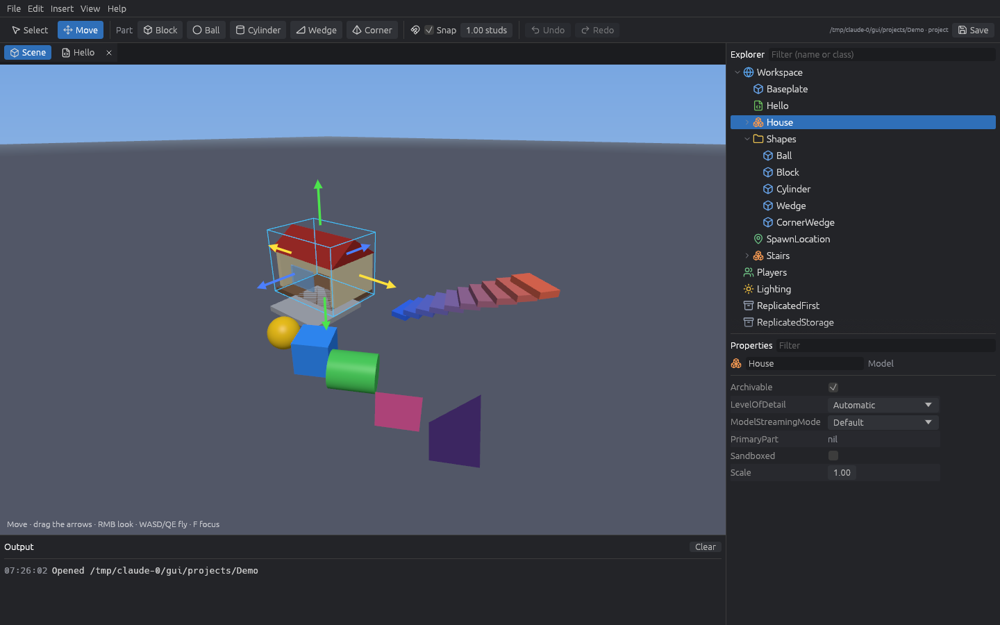
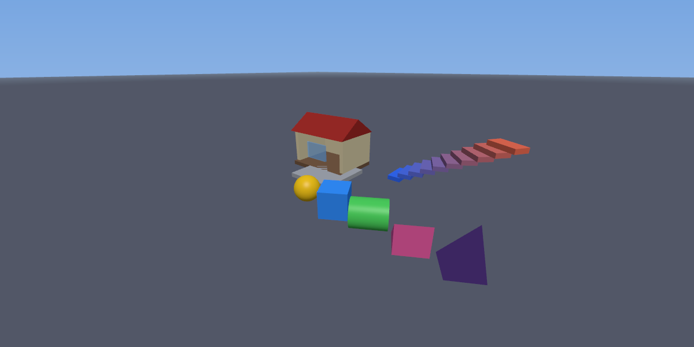

# Kahua

**An open source editor for Roblox places, native on Linux.**

Kahua opens and saves `.rbxl` places and Rojo projects, shows them in 3D, and lets you edit
instances, properties and scripts — without Wine, without Sober, and without an account.
It also runs headless: render screenshots of a place from the command line or in CI.



> **Status: early (v0.1).** Kahua is usable for building simple maps and editing scripts and
> properties, but it is not a full Roblox Studio replacement yet. See [what works](#what-works)
> and the [roadmap](#roadmap).

## What works

- **Projects like Godot's project manager:** create a project, open a folder, or import an
  existing `.rbxl` — every new project is a Rojo-compatible directory with git initialized.
- **Open and save place files directly** (`.rbxl`, `.rbxlx`, `.rbxm`, `.rbxmx`), lossless.
- **Explorer** with filtering, rename (F2), drag-and-drop to reparent, insert object, copy/paste,
  duplicate, group/ungroup.
- **Properties** for every property in the Roblox reflection database: checkboxes, numbers,
  vectors, colors, enums, text, plus Position and Orientation like Studio. Multi-selection edits.
- **3D viewport** for parts (block, ball, cylinder, wedge, corner wedge), colors and
  transparency, Studio-style camera (right mouse to look, WASD/QE to fly, wheel to zoom, F to focus),
  click to select, and a move tool with grid snapping.
- **Script editor** with Luau syntax highlighting and line numbers.
- **Undo/redo** for everything.
- **CLI and headless rendering** that need no display or GPU.



## Install

You need [Rust](https://rustup.rs) 1.95 or newer.

```sh
git clone https://github.com/Username59138/kahua
cd kahua
cargo install --path crates/kahua
```

On a server without a GPU, install a software Vulkan driver for rendering
(`sudo apt install mesa-vulkan-drivers` on Debian/Ubuntu). For a CLI-only build without the
editor window: `cargo install --path crates/kahua --no-default-features`.

## Usage

Run `kahua` to open the project manager, or open something directly:

```sh
kahua edit my-game/          # a project folder
kahua edit place.rbxl        # a place file
```

Command line, no window needed:

```sh
kahua new my-game                       # new project (baseplate template, git init)
kahua import place.rbxl my-game         # turn a place file into a project
kahua build my-game -o my-game.rbxl     # project -> place file (also .rbxlx/.rbxm)
kahua info place.rbxl --depth 3         # print the instance tree
kahua render my-game -o shot.png        # screenshot without a window
kahua render place.rbxl --focus Workspace.Car --width 1920 --height 1080
```

### Editor shortcuts

| Action | Keys |
| --- | --- |
| Look around / fly | Right mouse drag, WASD, Q/E (Shift = slower) |
| Zoom / focus selection | Mouse wheel / F |
| Select tool / Move tool | Ctrl+1 / Ctrl+2 |
| Select a part inside a model | Alt+click |
| Undo / Redo | Ctrl+Z / Ctrl+Y |
| Duplicate / Delete / Rename | Ctrl+D / Del / F2 |
| Copy / Paste / Paste into | Ctrl+C / Ctrl+V / Ctrl+Shift+V |
| Group / Ungroup | Ctrl+G / Ctrl+U |
| Rotate / Tilt 90° | Ctrl+R / Ctrl+T |
| Save | Ctrl+S |

## Project format

A Kahua project is a [Rojo](https://rojo.space) project, so you can keep using `rojo serve`
with Roblox Studio and Kahua side by side:

```
my-game/
├── default.project.json    # Rojo project file
├── kahua.toml              # Kahua settings (safe to commit)
└── src/
    ├── Workspace/
    │   ├── Baseplate.model.json
    │   └── Car/
    │       ├── init.meta.json
    │       ├── Body.model.json
    │       └── Drive.client.luau
    └── ServerScriptService/
        └── Main.server.luau
```

- Scripts are plain `.luau` files. Instances that contain scripts become folders.
- Everything else is a readable `.model.json`, so map changes show up as small git diffs.
- Instances that reference each other (welds, `PrimaryPart`) or hold binary data are stored as
  `.rbxm` so nothing is lost.
- Existing Rojo projects keep their own layout: Kahua writes changes back where they came from
  and only deletes files it loaded itself.

## How it's built

| Crate | What it does |
| --- | --- |
| `kahua-io` | Place files and Rojo projects, on top of [rbx-dom](https://github.com/rojo-rbx/rbx-dom) |
| `kahua-core` | The document, selection and undo/redo |
| `kahua-render` | wgpu renderer used by both the window and `kahua render` |
| `kahua-gui` | The editor window (egui) |
| `kahua` | The `kahua` command |

## Roadmap

- MeshParts, unions and textures (downloading assets needs an optional account login)
- Rotate and scale tools, surface snapping
- Luau autocompletion and type checking via luau-lsp
- Optional login to publish places (internal Studio endpoints or Open Cloud)
- Terrain, GUI editing, a minimal playtest mode

Contributions are welcome — open an issue to talk about bigger changes first.

## License

Kahua is free software under the [GNU GPL v3 or later](LICENSE). The license covers Kahua's
code only: places and projects you make with Kahua are yours.

Icons are from [Lucide](https://lucide.dev) (ISC license, see `crates/kahua-gui/assets/icons/LICENSE`).

Kahua is not affiliated with, endorsed by, or connected to Roblox Corporation. "Roblox" and
"Roblox Studio" are trademarks of Roblox Corporation.
